# Food delivery

Databases and backend for a food delivery business in Portuguese cities: customers order from restaurants, couriers deliver, and the back office reads reports. There is no frontend and no authentication; every flow is an HTTP endpoint.

- **PostgreSQL** is the source of truth for everything that must never be lost or contradict itself (orders, stock, offers, payments).
- **MongoDB** keeps the courier position trail (7-day TTL) and the derived report collections.
- **Redis** keeps real-time state: courier positions and presence, pending offers (45 s), tracking cache, daily stock copies, rankings.

The technical focus is **concurrency**: an order is assigned to exactly one courier, daily stock never goes below zero, a courier never exceeds the vehicle's delivery limit, and a restaurant never exceeds its kitchen capacity, even under simultaneous requests.

## How to run (from a clean clone)

### Requirements

- Docker with Docker Compose v2
- [uv](https://docs.astral.sh/uv/getting-started/installation/) (it installs Python 3.12 by itself if it is missing)
- Bash and Git (macOS, Linux or WSL)

### 1. Stop the module environment first

The module's own environment publishes the **same ports** (5432, 27017, 6379). Stop it before starting this project, in the module repo:

```bash
docker compose down
```

### 2. Start, set up and seed

```bash
git clone <this-repo-url> food-delivery && cd food-delivery
cp .env.example .env        # you may replace the CHANGE_ME passwords; keep each URL and its *_PASSWORD equal
docker compose up -d        # postgres, mongo, redis and the api (built from the Dockerfile)
./scripts/setup.sh          # database, roles, extensions, migrations, Mongo user, collections and indexes
./scripts/seed.sh           # demo data in PG and Mongo, report export, Redis rebuild
```

`setup.sh` waits for the databases to be ready and can be run any number of times.

### 3. Check that it works

```bash
curl http://127.0.0.1:8000/health    # {"status":"ok","postgres":"ok","mongo":"ok","redis":"ok"}
```

- API docs (OpenAPI): <http://127.0.0.1:8000/docs>
- Every port is published on `127.0.0.1` only:

| Service | Port |
|---|---|
| API | 8000 |
| PostgreSQL | 5432 |
| MongoDB | 27017 |
| Redis | 6379 |
| DbGate (optional) | 3000 |

### 4. Run the concurrency tests

Each scenario fires all contested requests at the same time and checks the rule in PostgreSQL. `--mode naive` uses the unprotected code path to show the race; `--mode real` must keep the rule with no 5xx.

```bash
uv run python tests/concurrency/run.py --scenario same-order --mode real      # 50 couriers, 1 order: exactly 1 wins
uv run python tests/concurrency/run.py --scenario same-order --mode naive
uv run python tests/concurrency/run.py --scenario last-portions --mode real   # 60 orders, 30 portions: 30 placed, stock 0
uv run python tests/concurrency/run.py --scenario last-portions --mode naive
uv run python tests/concurrency/run.py --scenario vehicle-limit --mode real   # extension: a scooter with 1 delivery accepts 5 offers: 1 fits
uv run python tests/concurrency/run.py --scenario vehicle-limit --mode naive
```

The script exits with 1 if the rule is broken (or, in real mode, on any 5xx), else 0. The naive paths only exist while `ENABLE_NAIVE_MODE=true` in `.env`. Outputs and explanation: [docs/concurrency.md](docs/concurrency.md).

### Other useful commands

```bash
# rebuild every derived Redis key from PG/Mongo, then compare (exit 1 on any difference)
uv run python redis/rebuild.py
uv run python redis/verify.py

# migrations (always run as the owner role, via MIGRATION_DATABASE_URL)
uv run alembic -c postgres/alembic.ini upgrade head
uv run alembic -c postgres/alembic.ini downgrade -1

# run the API on the host with auto-reload (stop the api container first: same port)
docker compose stop api
uv run uvicorn app.main:app --reload

# lint and tests
uv run ruff check . && uv run ruff format --check .
uv run pytest

# start again from zero (deletes all data)
docker compose down -v
```

### Troubleshooting

- **`port is already allocated`**: another environment (usually the module's) uses the same port. Stop it (step 1).
- **Authentication errors after changing a password in `.env`**: `setup.sh` re-applies the passwords of `fd_owner`, `fd_app`, `fd_readonly` and the Mongo `fd_app` user. The PostgreSQL superuser and Mongo root passwords are only set when the data volume is first created; to change them, run `docker compose down -v` and start again.
- **`/health` answers 503 right after `docker compose up -d`**: expected until `setup.sh` has created the app users.

### DbGate (optional, development only)

A web client for PostgreSQL, MongoDB and Redis, to inspect data. It is in the `tools` profile, so `docker compose up -d` does **not** start it, and nothing in the project depends on it. In PostgreSQL it connects as the read-only role.

```bash
docker compose --profile tools up -d dbgate     # http://127.0.0.1:3000
docker compose --profile tools stop dbgate
```

The evidence in `docs/` (`EXPLAIN`, `explain("executionStats")`, Redis `MONITOR`) is taken with `psql`, `mongosh` and `redis-cli`, not with DbGate.

### Dev container (optional)

`.devcontainer/` opens the repo in VS Code (or Codespaces) inside a container with Python 3.12, uv and the Docker CLI, next to the three databases. After `cp .env.example .env`, run **Dev Containers: Reopen in Container**, then in its terminal `./scripts/setup.sh`, `./scripts/seed.sh` and `uv run uvicorn app.main:app --host 0.0.0.0 --reload`. Nothing depends on it: the commands above, on the host, are the reference.

## Stack

| Concern | Tool | Why |
|---|---|---|
| Language | Python 3.12 | One language for the API, scripts, seed and tests |
| Packages / env | uv | Fast, one lock file (`uv.lock`) for identical installs on every machine and in Docker |
| API | FastAPI + Uvicorn | Validation and OpenAPI docs from type hints; `def` endpoints run in a thread pool, so concurrent requests really hit the database at the same time |
| PostgreSQL access | SQLAlchemy 2.0 (sync) + psycopg 3 | Typed models, parameterised queries, explicit transactions and row locks (`FOR UPDATE`) |
| Migrations | Alembic | Versioned schema with a working downgrade; constraints and grants the ORM cannot express go in `op.execute` |
| MongoDB access | pymongo | Plain sync driver; aggregation pipelines written as Python dicts |
| Redis access | redis-py | Lua scripts for multi-step atomic operations |
| Concurrency test | httpx `AsyncClient` + `asyncio.gather` | Fires all contested requests at once |
| Settings | pydantic-settings | Reads `.env`; no secret in the code |
| Lint / tests | ruff, pytest | |
| Runtime | Docker Compose | The same three databases and API for everyone, one command |

Sync drivers everywhere: simpler to read and explain, and FastAPI's thread pool still gives real concurrency against the databases.

## Data model

PostgreSQL, drawn from the foreign keys in the database. Each line says what happens to the child rows when the parent is deleted (`RESTRICT` refuses the delete). Only keys and columns with a rule are shown; every column is in [docs/database-structure.md](docs/database-structure.md) and every constraint in [docs/postgres.md](docs/postgres.md).

```mermaid
erDiagram
    cities ||--o{ zones : "RESTRICT"
    zones ||--o{ zone_fees : "restaurant_zone_id, RESTRICT"
    zones ||--o{ zone_fees : "customer_zone_id, RESTRICT"
    zones ||--o{ customer_addresses : "RESTRICT"
    zones ||--o{ restaurants : "RESTRICT"
    zones ||--o{ orders : "delivery_zone_id, RESTRICT"
    customers ||--o{ customer_addresses : "CASCADE"
    customers ||--o{ orders : "RESTRICT"
    customer_addresses |o--o{ orders : "source_address_id, SET NULL"
    restaurants ||--o{ restaurant_cuisines : "CASCADE"
    cuisines ||--o{ restaurant_cuisines : "RESTRICT"
    restaurants ||--o{ opening_periods : "CASCADE"
    restaurants ||--o{ menu_categories : "CASCADE"
    menu_categories ||--o{ menu_items : "RESTRICT"
    menu_items ||--o{ daily_stock : "CASCADE"
    restaurants ||--o{ orders : "RESTRICT"
    orders ||--|{ order_lines : "CASCADE"
    menu_items ||--o{ order_lines : "RESTRICT"
    orders ||--|{ order_status_history : "RESTRICT"
    orders ||--o{ payments : "RESTRICT"
    orders ||--o{ delivery_offers : "RESTRICT"
    couriers ||--o{ delivery_offers : "RESTRICT"
    orders ||--o| deliveries : "RESTRICT"
    couriers ||--o{ deliveries : "RESTRICT"
    orders ||--o| ratings : "RESTRICT"
    restaurants ||--o{ ratings : "RESTRICT"

    cities {
        int id PK
        varchar name UK
    }
    zones {
        int id PK
        int city_id FK "UNIQUE (city_id, name)"
    }
    zone_fees {
        int id PK
        int restaurant_zone_id FK "UNIQUE with customer_zone_id"
        int customer_zone_id FK
        numeric fee "CHECK >= 0"
    }
    customers {
        int id PK
        varchar email UK
        varchar phone UK
    }
    customer_addresses {
        int id PK
        int customer_id FK
        int zone_id FK
        boolean is_default "one default per customer (partial UNIQUE)"
    }
    restaurants {
        int id PK
        int zone_id FK
        varchar nif UK "CHECK 9 digits"
        numeric min_order_value "CHECK >= 0"
        int kitchen_capacity "CHECK > 0 (rule 4)"
        varchar status "open, closed, suspended"
    }
    cuisines {
        int id PK
        varchar name UK
    }
    restaurant_cuisines {
        int restaurant_id PK, FK
        int cuisine_id PK, FK
    }
    opening_periods {
        int id PK
        int restaurant_id FK
        smallint weekday "0 Monday .. 6"
        int4range hours "minutes 0-1440, EXCLUDE overlap"
    }
    menu_categories {
        int id PK
        int restaurant_id FK
    }
    menu_items {
        int id PK
        int category_id FK
        numeric price "CHECK >= 0"
        int daily_stock "NULL = no limit"
        jsonb options
    }
    daily_stock {
        int item_id PK, FK
        date stock_date PK "Lisbon day"
        int remaining "CHECK >= 0 (rule 2)"
    }
    orders {
        int id PK
        int customer_id FK
        int restaurant_id FK
        int source_address_id FK "address snapshot in the row"
        int delivery_zone_id FK
        numeric total "CHECK = subtotal + fee + tip"
        varchar status "placed .. delivered, cancelled, rejected"
    }
    order_lines {
        int id PK
        int order_id FK
        int item_id FK
        int quantity "CHECK >= 1"
        numeric unit_price "snapshot"
        jsonb options "snapshot"
    }
    order_status_history {
        int id PK
        int order_id FK "append-only for fd_app"
    }
    payments {
        int id PK
        int order_id FK
        varchar provider_ref UK "NULL only for cash"
        varchar status "approved, declined, refunded"
    }
    couriers {
        int id PK
        varchar email UK
        varchar phone UK
        varchar licence_plate UK "NULL only for bicycle"
        varchar vehicle_type "bicycle 1, scooter 2, car 3 (rule 3)"
    }
    delivery_offers {
        int id PK
        int order_id FK
        int courier_id FK
        varchar outcome "pending, accepted, rejected, expired, withdrawn"
    }
    deliveries {
        int id PK
        int order_id FK, UK "rule 1: one courier per order"
        int courier_id FK
    }
    ratings {
        int id PK
        int order_id FK, UK "one rating per order"
        int restaurant_id FK
        smallint restaurant_score "CHECK 1-5"
        smallint courier_score "CHECK 1-5"
    }
```



## API

_To do: endpoints per flow (F1–F8) and how the actor is identified (`/customers/{id}/...`, `/restaurants/{id}/...`, `/couriers/{id}/...`, `/backoffice/...`)._ Full reference: <http://127.0.0.1:8000/docs>.

## Extensions done

- **Rule 3 test scenario (vehicle limit):** `tests/concurrency/vehicle_limit.py`, naive and real modes. Outputs in [docs/concurrency.md](docs/concurrency.md).

_Others: to do._

## Documentation

- [docs/architecture.md](docs/architecture.md): sources of truth, sequence diagrams, failure handling, security
- [docs/postgres.md](docs/postgres.md): schema, constraints, roles and grants, `EXPLAIN` evidence
- [docs/mongodb.md](docs/mongodb.md): collections, validators, report pipelines
- [docs/redis.md](docs/redis.md): every key pattern, TTLs, persistence, cache evidence
- [docs/concurrency.md](docs/concurrency.md): the four rules, locks, isolation level, test outputs
- [docs/runbook.md](docs/runbook.md): backup, restore and verification per engine
- [docs/ai-usage.md](docs/ai-usage.md): how AI tools were used
