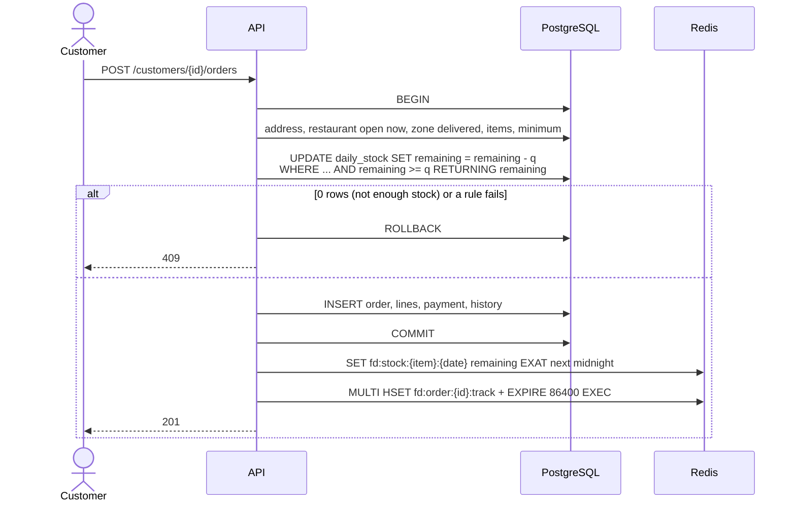
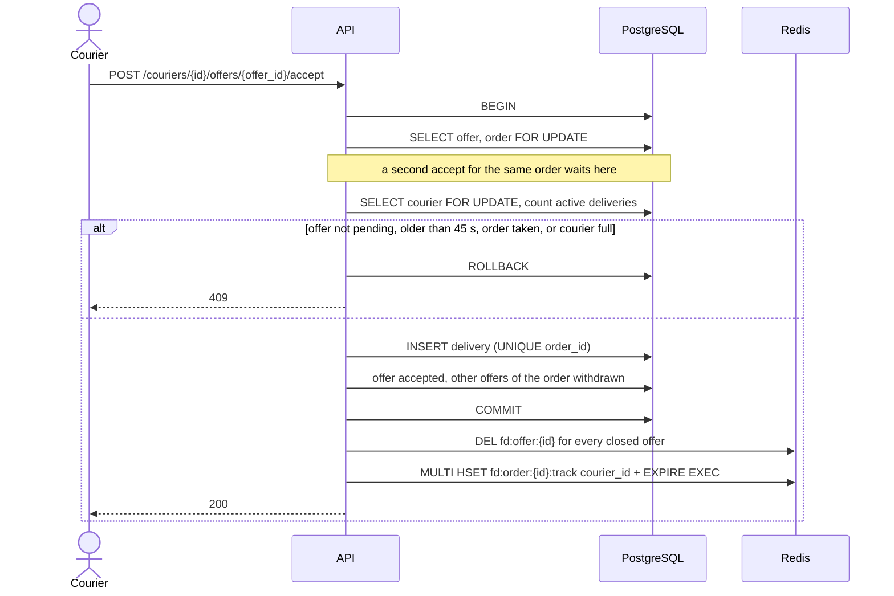
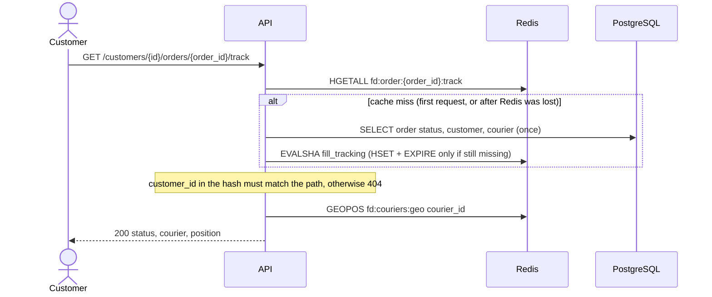

# Architecture

Three engines, each for what it does best:

- **PostgreSQL** is the source of truth for everything that must never be lost or contradict itself: catalogue, customers, orders, payments, offers, deliveries, ratings, daily stock. All four concurrency rules are enforced on it (see [concurrency.md](concurrency.md)).
- **MongoDB** holds the courier position trail (source of truth, 7 days) and the report collections, which are derived from PostgreSQL (see [mongodb.md](mongodb.md)).
- **Redis** holds real-time state: live courier positions and presence, pending offers, the tracking cache, today's stock copy and the last-hour ranking.

The API (FastAPI, sync) talks to the three. **Rule for every flow:** PostgreSQL commits first, then the app writes Redis or MongoDB. A rollback therefore never leaves Redis showing something that did not happen.

## Sources of truth

| Data | Owner (source of truth) | Copies | When they disagree | Lost if that engine is lost |
|---|---|---|---|---|
| Cities, zones, fees, customers, restaurants, hours, menus | PostgreSQL | Names copied into `report_orders` | PostgreSQL wins; the export rewrites the copy | Restored from the PG backup (see [runbook.md](runbook.md)) |
| Orders, lines, payments, status history | PostgreSQL | `report_orders` (Mongo), `fd:order:{id}:track` (Redis) | PostgreSQL wins; `redis/verify.py` finds a wrong hash, `redis/rebuild.py` and the export rewrite the copies | Commits since the last archived WAL (at most about 1 minute) |
| Daily stock (portions left today) | PostgreSQL (`daily_stock`) | `fd:stock:{item_id}:{date}` (Redis) | PostgreSQL wins; F2 always takes stock in PG | Same as orders |
| Delivery offers and their outcome | PostgreSQL (`delivery_offers`) | `fd:offer:{offer_id}` (Redis, 45 s), `report_offers` (Mongo) | PostgreSQL wins; F4 never trusts the Redis key | Same as orders |
| Deliveries (which courier has which order) | PostgreSQL (`deliveries`) | `courier_id` in the tracking hash | PostgreSQL wins | Same as orders |
| Ratings | PostgreSQL | none | — | Same as orders |
| Courier position trail | MongoDB (`courier_positions`, 7 days) | none | — | Positions since the last daily dump |
| Courier live position | Redis (`fd:couriers:geo`) | The trail keeps every position too | Redis is the live one; the trail is history | Nothing lasting: every online courier sends a new position within seconds |
| Courier online presence | Redis (`fd:courier:{id}:online`, 30 s) | none | — | Couriers look offline until their next position (seconds) |
| Report collections | Derived (PostgreSQL) | — | PostgreSQL wins; the export rewrites them | Nothing: `mongodb/export_reports.py` |
| Tracking cache, stock copy, ranking | Derived (PostgreSQL) | — | PostgreSQL wins | Nothing: `redis/rebuild.py`, and the tracking cache also refills on a miss |

## How data moves in each flow

| Flow | PostgreSQL | MongoDB | Redis |
|---|---|---|---|
| F1 Browse | Reads restaurants open now, fees, ratings, menu | — | — |
| F2 Place order | One transaction: checks, stock taken with a conditional `UPDATE`, order, lines, payment, history | — | After commit: stock copy, tracking hash |
| F3 Restaurant accepts | Locks the restaurant row (rule 4), status `accepted`, offers inserted | — | Before commit: `GEOSEARCH` 3 km + online check. After commit: offer keys (`EX 45`), tracking hash |
| F4 Courier accepts | Locks offer, order and courier (rules 1 and 3), inserts the delivery, closes the other offers | — | After commit: deletes closed offer keys, tracking hash gets the courier |
| F5 Status updates | Status change + history row in one transaction; a cancel gives stock back and adds a refund | — | After commit: tracking hash, stock copy; on `delivered`, the ranking bucket (`record_delivery`, *to do: RodrigoDias123*) |
| F6 Track | Only on a cache miss, once | — | `HGETALL` the tracking hash, `GEOPOS` the courier |
| F7 Location | `/online` checks the courier exists and is active | Each position appended to `courier_positions` | Lua script: `GEOADD` + `SET fd:courier:{id}:online EX 30` |
| F8 Reports | Read by the export (`fd_readonly`) | Pipelines run on `report_orders` | — |

### F2: place order

### F4: courier accepts an offer

### F6: track an order

A repeated request runs only the two Redis commands. The evidence (`MONITOR` next to the PostgreSQL log with `log_statement = 'all'`) is in [redis.md](redis.md).

## When the second write fails

PostgreSQL always commits first. A Redis or MongoDB write after it can fail (engine down, network). What happens then:

| Write that fails | Effect | How it is repaired |
|---|---|---|
| Tracking hash (F2, F3, F4, F5) | Logged only; the request still answers 2xx because the order is committed. The hash may show the old status. | The hash expires in 24 h; `redis/verify.py` reports it and `redis/rebuild.py` rewrites it. If the key is missing, the next F6 request fills it from PG. |
| Stock copy (F2, F5 cancel) | Logged only. The copy shows an old number. | F2 never reads the copy: it takes stock in PG, so rule 2 still holds. `verify.py` finds it, `rebuild.py` fixes it, and the next order of that item writes it again. |
| Offer keys (F3) | The offer is in PG but has no Redis key. | F4 checks the offer in PG (`pending` and `sent_at` less than 45 s ago), never the key, so the courier can still accept. |
| Deleting offer keys (F4) | A closed offer keeps its key until its 45 s TTL. | Harmless: F4 reads PG and answers 409. |
| Ranking bucket (on `delivered`) | The restaurant misses one delivery in the ranking. | `rebuild.py` recomputes the last hour from PG `deliveries`; `verify.py` compares them. |
| Trail insert in MongoDB (F7) | The request returns 500; the live position in Redis is already right. | One trail point is lost. The next position, a few seconds later, is stored. |
| Report export | The report collections are stale. | Run `mongodb/export_reports.py` again: it empties and rewrites them. |

Known limit: two status changes of the same order a few milliseconds apart can reach Redis out of order and leave the older status in the hash. `verify.py` detects it and the next change or `rebuild.py` fixes it. PostgreSQL is never affected.

## State that changes with time

No worker service: every time-based state is computed when it is read, or expires on its own with a TTL.

| State | Rule from the brief | How it is handled | Where |
|---|---|---|---|
| Daily stock | Resets at midnight, Lisbon time | **Computed when read.** The PG row for today's Lisbon date is created from `menu_items.daily_stock` on first use (`INSERT ... ON CONFLICT DO NOTHING`), so the new day starts full with no job. The Redis copy uses `EXAT` next Lisbon midnight + 1 h, so yesterday's key goes away by itself. | PG `daily_stock` (truth), Redis copy |
| Delivery offer | Valid 45 s after it is sent | **Computed when read.** An offer is valid if PG says `pending` and `sent_at` is less than 45 s ago. It is marked `expired` lazily, when a courier answers it or when the order is offered again. The Redis key has `EX 45`, set in the same `MULTI` as the write. | PG `delivery_offers` (truth), Redis key (ephemeral) |
| Courier online | 30 s after their last position | **TTL.** `SET fd:courier:{id}:online 1 EX 30` in the same Lua script as `GEOADD`, refreshed on every position. No key means offline. F3 checks `EXISTS` on each courier `GEOSEARCH` returns. | Redis |
| Courier last position | While they are online | **Removed on offline.** `POST /couriers/{id}/offline` removes the member from `fd:couriers:geo`. A courier who just stops sending stays in the geo set, but F3 skips them because their online key expired. | Redis |
| Position trail | 7 days | **TTL index** `recorded_at_ttl` (`expireAfterSeconds: 604800`) on `courier_positions`. MongoDB deletes old documents by itself. | MongoDB |
| "Open now" | Opening hours in Lisbon time | **Computed when read.** F1 and F2 compare the Lisbon weekday and minute of the day with `opening_periods`. | PostgreSQL |
| Last-hour ranking | The last 60 minutes | **TTL.** One sorted set per city per minute (`EX 3900`, set in the same `MULTI` as `ZINCRBY`). The read is a `ZUNION` of the last 60 buckets, so older buckets just stop being read and then expire. | Redis |
| Tracking cache | — | **TTL** `EX 86400`: far longer than a delivery, and finished orders then leave memory. | Redis |

## Security

### Roles and users

| Engine | User | Used by | Can | Why |
|---|---|---|---|---|
| PostgreSQL | `postgres` (superuser) | `scripts/setup.sh` only | Everything | Creating the database, roles and the `btree_gist` extension needs it. The app never uses it. |
| PostgreSQL | `fd_owner` | Alembic migrations (`MIGRATION_DATABASE_URL`) | Owns the tables; creates and changes them | Schema changes are separate from the app, so a bug in the app cannot drop or alter a table. |
| PostgreSQL | `fd_app` | The API and the concurrency fixtures (`DATABASE_URL`) | `SELECT, INSERT, UPDATE, DELETE` on the tables, `USAGE, SELECT` on sequences; **no `UPDATE`, `DELETE` on `order_status_history`** | Least privilege: it can run the flows but cannot change the schema, create roles or rewrite the history. |
| PostgreSQL | `fd_readonly` | The report export (`READONLY_DATABASE_URL`), DbGate | `SELECT` only, and `default_transaction_read_only = on` | The export and the GUI cannot change data, even by mistake. |
| MongoDB | `root` | `scripts/setup.sh` (`mongodb/setup.py`) and the runbook only | Everything | Creating the app user, collections and validators. |
| MongoDB | `fd_app` (in `food_delivery`) | The API, the export, the Mongo seed | `readWrite` on `food_delivery` only | No user management and no access to other databases. |
| Redis | the `requirepass` password | The API and the Redis scripts | Every command | Redis has one password for the app; without it nobody on the network can read or write keys. |

- Roles are created with `NOSUPERUSER NOCREATEDB NOCREATEROLE`. `CONNECT` on `food_delivery` is revoked from `PUBLIC` and granted only to `fd_app` and `fd_readonly`.
- Grants come from `ALTER DEFAULT PRIVILEGES` in a migration, so every new table gets them with no extra `GRANT`.

### Other measures

- **No secrets in Git.** Every password comes from `.env` through `pydantic-settings` and Compose interpolation; `.env` is in `.gitignore`, and `.env.example` has only placeholders.
- **Parameterised queries everywhere.** SQLAlchemy expressions or `text()` with bound parameters; MongoDB filters built from typed values; Redis keys built from validated integer ids.
- **Ports on `127.0.0.1` only.** PostgreSQL, MongoDB, Redis and DbGate are not reachable from other machines.
- **Validation at the edges.** Pydantic checks every request body (422), and the databases refuse invalid data on their own (`CHECK`, `UNIQUE`, `EXCLUDE`, `$jsonSchema` with `validationAction: "error"`).
