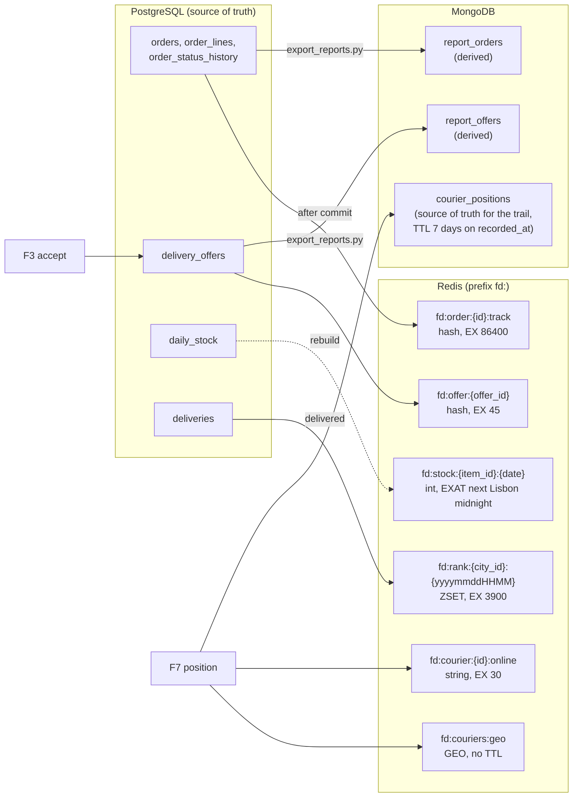

# Database structure

How the data is split between PostgreSQL, MongoDB and Redis. The PostgreSQL diagram is drawn by hand from `app/models/` and the migrations in `postgres/migrations/versions/`; keep it in sync when a table changes.

## PostgreSQL (source of truth)

Tables marked **planned** in the column notes do not exist yet (offers, deliveries, ratings); their columns follow `planning/PLAN.md` and may change.

```mermaid
erDiagram
    cities ||--o{ zones : "has"
    zones ||--o{ zone_fees : "restaurant_zone_id"
    zones ||--o{ zone_fees : "customer_zone_id"
    zones ||--o{ customer_addresses : "located in"
    zones ||--o{ restaurants : "located in"
    zones ||--o{ orders : "delivery_zone_id"

    customers ||--o{ customer_addresses : "has (CASCADE)"
    customers ||--o{ orders : "places (RESTRICT)"
    customer_addresses |o--o{ orders : "source_address_id (SET NULL)"

    restaurants ||--o{ restaurant_cuisines : "has (CASCADE)"
    cuisines ||--o{ restaurant_cuisines : "used by (RESTRICT)"
    restaurants ||--o{ opening_periods : "opens (CASCADE)"
    restaurants ||--o{ menu_categories : "has (CASCADE)"
    menu_categories ||--o{ menu_items : "contains (RESTRICT)"
    menu_items ||--o{ daily_stock : "stock per day (CASCADE)"

    restaurants ||--o{ orders : "receives (RESTRICT)"
    orders ||--|{ order_lines : "has (CASCADE)"
    menu_items ||--o{ order_lines : "ordered as (RESTRICT)"
    orders ||--|{ order_status_history : "logs (RESTRICT)"
    orders ||--o{ payments : "paid / refunded (RESTRICT)"

    couriers ||--o{ delivery_offers : "receives"
    orders ||--o{ delivery_offers : "offered as"
    orders ||--o| deliveries : "UNIQUE order_id"
    couriers ||--o{ deliveries : "delivers"
    orders ||--o| ratings : "UNIQUE order_id"

    cities {
        int id PK
        varchar name UK
    }
    zones {
        int id PK
        int city_id FK
        varchar name "UNIQUE (city_id, name)"
    }
    zone_fees {
        int id PK
        int restaurant_zone_id FK
        int customer_zone_id FK "UNIQUE with restaurant_zone_id"
        numeric fee "CHECK >= 0"
    }
    customers {
        int id PK
        varchar name
        varchar email UK
        varchar phone UK
        varchar password_hash
        timestamptz registered_at
    }
    customer_addresses {
        int id PK
        int customer_id FK
        int zone_id FK
        varchar street
        varchar number
        varchar floor "nullable"
        varchar postcode
        text notes "nullable"
        numeric lat
        numeric lng
        boolean is_default "partial UNIQUE: one default per customer"
    }
    cuisines {
        int id PK
        varchar name UK
    }
    restaurants {
        int id PK
        int zone_id FK
        varchar name
        varchar nif UK "CHECK 9 digits"
        varchar address
        numeric lat
        numeric lng
        numeric min_order_value "CHECK >= 0"
        int kitchen_capacity "CHECK > 0"
        varchar status "open | closed | suspended"
    }
    restaurant_cuisines {
        int restaurant_id PK, FK
        int cuisine_id PK, FK
    }
    opening_periods {
        int id PK
        int restaurant_id FK
        smallint weekday "0 = Monday .. 6"
        int4range hours "minutes [0,1440), EXCLUDE overlap"
    }
    menu_categories {
        int id PK
        int restaurant_id FK
        varchar name
    }
    menu_items {
        int id PK
        int category_id FK
        varchar name
        text description "nullable"
        numeric price "CHECK >= 0"
        varchar status "available | unavailable"
        int daily_stock "configured portions, NULL = no limit"
        jsonb options
    }
    daily_stock {
        int item_id PK, FK
        date stock_date PK "Lisbon day, created lazily"
        int remaining "CHECK >= 0 (rule 2)"
    }
    orders {
        int id PK
        int customer_id FK
        int restaurant_id FK
        int source_address_id FK "nullable"
        text delivery_street "address snapshot"
        varchar delivery_number
        varchar delivery_floor "nullable"
        varchar delivery_postcode
        int delivery_zone_id FK
        numeric delivery_lat
        numeric delivery_lng
        text delivery_notes "nullable"
        numeric subtotal "CHECK >= 0"
        numeric delivery_fee "CHECK >= 0"
        numeric tip "CHECK >= 0"
        numeric total "CHECK = subtotal + fee + tip"
        varchar status "placed .. delivered, cancelled, rejected"
        varchar cancel_reason "fixed list, required if cancelled"
        varchar cancelled_by "customer | restaurant | backoffice"
        timestamptz created_at
    }
    order_lines {
        int id PK
        int order_id FK
        int item_id FK
        text item_name "snapshot"
        int quantity "CHECK >= 1"
        numeric unit_price "snapshot, item + options"
        jsonb options "chosen options snapshot"
    }
    order_status_history {
        int id PK
        int order_id FK
        varchar old_status "NULL on creation"
        varchar new_status
        varchar actor_type
        int actor_id "nullable"
        timestamptz changed_at "append-only: no UPDATE/DELETE for fd_app"
    }
    payments {
        int id PK
        int order_id FK
        numeric amount "CHECK >= 0"
        varchar method "card | mbway | cash"
        varchar status "approved | declined | refunded"
        timestamptz paid_at
        varchar provider_ref UK "NULL only for cash"
    }
    couriers {
        int id PK
        varchar name
        varchar email UK
        varchar phone UK
        varchar vehicle_type "bicycle 1 | scooter 2 | car 3 active deliveries"
        varchar licence_plate UK "CHECK: NULL only for bicycle"
        varchar status "active | blocked"
    }
    delivery_offers {
        int id PK "planned"
        int order_id FK "UNIQUE with courier_id"
        int courier_id FK
        timestamptz sent_at "valid for 45 s"
        varchar outcome "pending | accepted | rejected | expired | withdrawn"
    }
    deliveries {
        int id PK "planned"
        int order_id FK, UK "rule 1: one courier per order"
        int courier_id FK
        timestamptz accepted_at
        timestamptz picked_up_at
        timestamptz delivered_at
        numeric distance_km "CHECK >= 0"
    }
    ratings {
        int id PK "planned"
        int order_id FK, UK "one rating per order"
        smallint score "CHECK 1-5"
    }
```

## MongoDB and Redis

Where each collection and key comes from. Solid arrows are writes by the app or scripts; dotted arrows are rebuilds from the source of truth.

